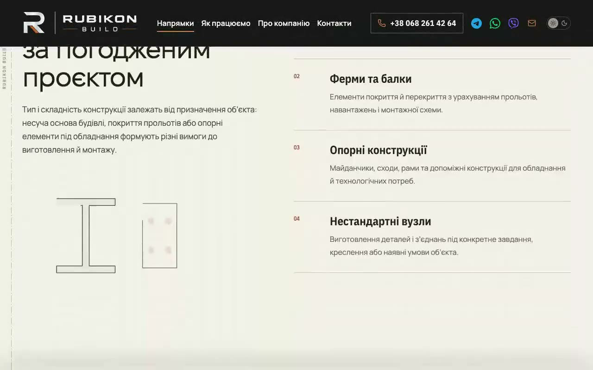

# Handoff · Рух: жива Колода, переходи сторінок, світло на матеріалах

| | |
|---|---|
| Дата | 2026-11-01 |
| Виконавець | Claude Code |
| Підстава | Власник, 01.11, після merge #291 і #292: «додамо більше преміальних анімацій… головне результат» |
| PR | PR_LINK, Draft. **Merge і production deploy — лише з окремого OK Дмитра** (DEC-30) |
| Гілка / base | `design/motion-signature` від `main` `e72daa01` |
| Коміти | `4c210e21` — рух і тести · наступний коміт — цей handoff |
| Змінено | `app/motion.css`, `SiteReveal.tsx`, `MaterialLight.tsx` (нові), `FooterSignature.tsx`, `app/layout.tsx`, `docs/ui-system-v1.md`, `tests/e2e/motion-signature.spec.ts` |
| Не змінено | Тексти, форма, залежності, бюджети, еталони, CSP. Нової бібліотеки немає: CSS і два маленькі клієнтські компоненти |

## Що було

Затверджена специфікація Motion v1 мала M2 (жести) і M3 (переходи) ще не зробленими, блоки поза першим екраном з'являлись без руху, а Колода була намальована, але не працювала.

## Що зроблено

1. **Жива Колода.** Прочитаний блок затримується, трохи осідає до 94 %, наступний наїжджає зверху. Починається, коли низ блоку пройшов середину екрана, щоб кінець блоку можна було дочитати. Один scroll-driven `transform`, без скрипта, довжина сторінки не змінюється, скрол не перехоплюється. Блок конфігуратора не бере участі: його повноекранний режим `position: fixed`.
2. **Переходи між сторінками.** `@view-transition`: стара сторінка осідає, нова наїжджає аркушем, шапка стоїть. Браузер без підтримки просто змінює сторінку.
3. **Поява блоку.** Мідна риска малюється, заголовок виходить із-під власного краю, лід за ним. Жести зі специфікації, раз на перегляд, лише нижче першого екрана.
4. **Світло за курсором** на матеріалах. Лише миша або трекпад. Рух одного шару `transform`, цикл зупиняється, щойно світло дійшло.
5. **Смуга світла на тисненому RUBIKON**, коли футер заходить на екран.

**Відхилено:** мідна лінія ізоліній, що малюється біля форми: майже вся під карткою форми, ефекту немає, а код на кожній сторінці. Справжній `position: sticky` для стосу: ламає якорі назад. Плашки, що ламають текст на рядки: специфікація забороняє.

**Відхилення від специфікації:** контролер `SiteReveal` окремий від `ProcessMotion`, щоб не зачіпати сторінкові `[data-motion]`. Жест `wipe`, `rise-group`, вхід героя й штамп не робились. Перехід сторінок: аркуш замість згасання зі специфікації 6.1, бо це мова Колоди.

## Перевірка

| Перевірка | Команда / прогін | Результат |
|---|---|---|
| Типи, lint, unit | `tsc`, `eslint .`, `vitest run` | чисто, 1723 passed |
| Збірка | `vinext build` | успішно |
| Цільові e2e, production-збірка | 19 наборів, desktop + mobile | 544 passed, 121 skipped, 4 failed, розбір нижче |
| Після правок | `motion-signature`, `responsive-a11y-phase1` | 28 passed, потім `motion-signature` 20/20 при повторі ×2 |
| Плавність, Chrome на Mac, headless, `/metalokonstruktsii`, 1440, колесо 5600 px, 3 прогони | rAF | p50 16,7 мс, p99 16,8 мс, кадрів понад 50 мс: 1 із ~1650 |
| Точність затримки | `translateY` проти скролу | +99,5 на 100 px, +399,5 на 400 px |

Розбір чотирьох падінь: 2 у новому тесті, виправлено. 2 у `responsive-a11y-phase1` — справжній дефект: Shift+Tab лишав фокус під шапкою, бо затриманий блок намальовано не на його місці. Виправлено: фокус із клавіатури всередині сторінки вимикає затримку.

## Еталони

Не змінювались. Очікується: скрипти й анімації не діють на статичні знімки; `visual` CI покаже. Оновлення лише з OK власника (DEC-18).

## Успадковані червоні перевірки

Немає відомих.

## Ризики

- **Safari й iPhone не перевірені.** Це головне. Власник працює в Safari з трекпадом. `view()` є в Safari 26 і новіших. Точність затримки на iPhone залежить від того, чи анімація йде разом зі скролом, а панель адреси змінює висоту екрана.
- Шари блоків на телефоні: блок під час анімації компонується окремо, пам'ять iPhone не міряна.
- Lenis: `scrollTo` на якір усередині блоку, що саме затримується, може промахнутись на величину зсуву. Лише вгору і лише для частково закритого блоку.
- Перетин із Draft #268 (`content-visibility`) той самий, що в #292.

## Що перевірити власнику

1. Прев'ю на iPhone і в Safari: чи блок стоїть рівно, без тремтіння, поки наїжджає наступний.
2. Чи подобається глибина осідання 94 % і момент початку.
3. Переходи між сторінками.

## Відкат

Revert PR. Часткове вимкнення: `@view-transition` і `stack-hold` живуть у `app/motion.css`, кожен рух окремим блоком.

## Пропоновані оновлення control (лише після OK)

`DECISIONS`: рішення власника 01.11 розширює §6.8: блок цілком слідує за скролом без пін-у. M2 частково, M3-1 зроблено.
