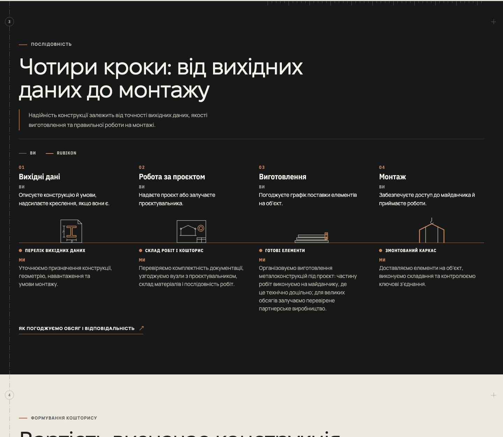
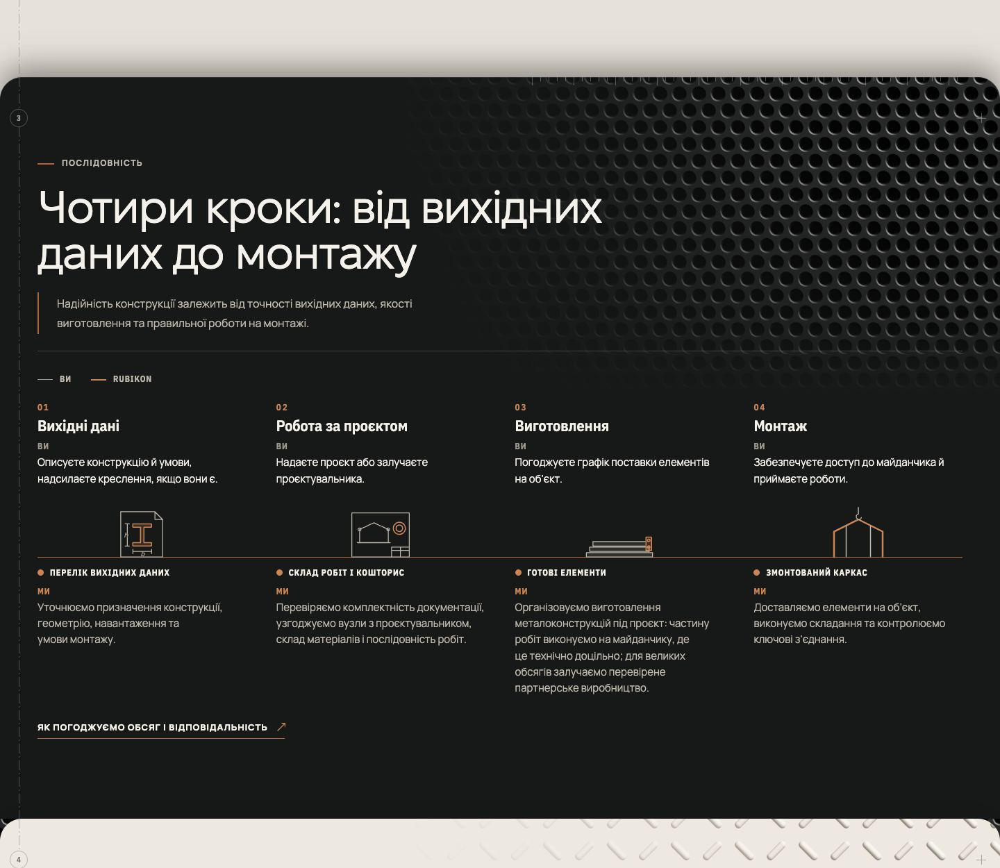
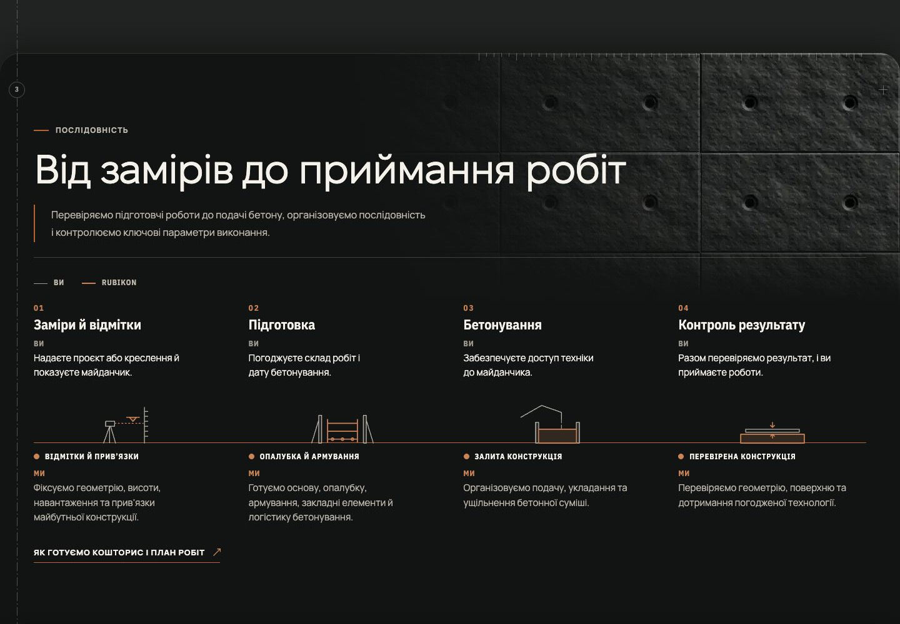
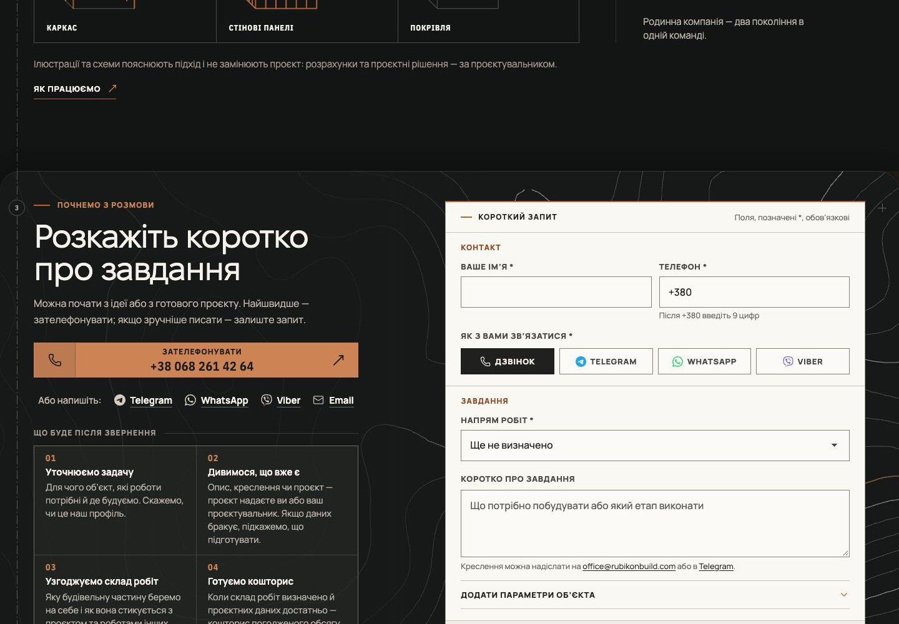
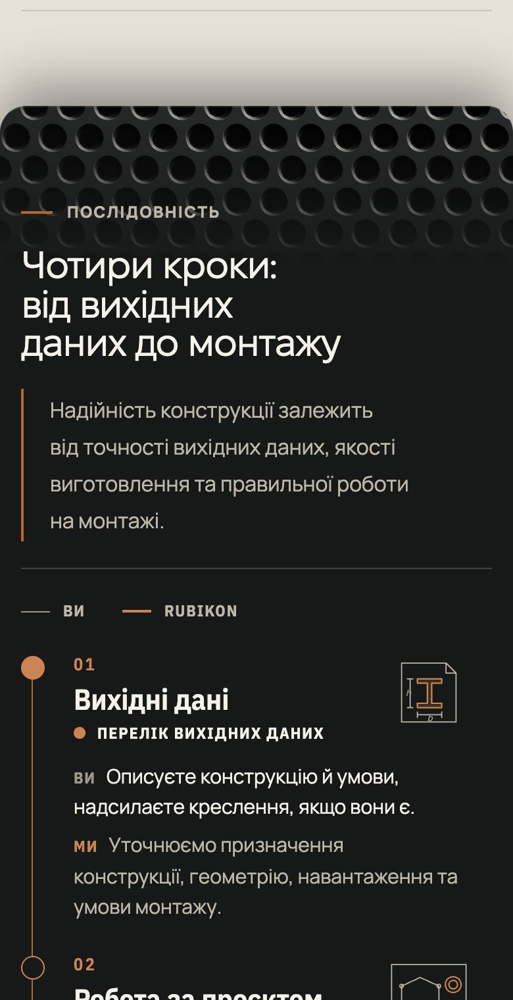
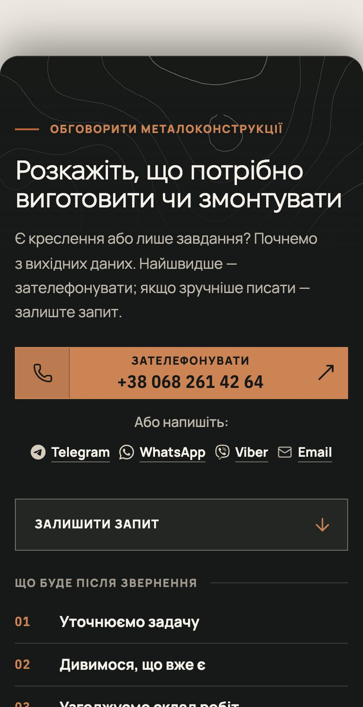

# Handoff · Сторінки: Колода, матеріали, форма на рельєфі

| | |
|---|---|
| Дата | 2026-11-01 |
| Виконавець | Claude Code |
| Підстава | Власник, 01.11, після шести етапів макетів: «Колода сподобалася», «ізолінії взагалі топ», «По сторінкам також відкрий PR все круто». Макети власник бачив на полотні, рішення про них — у розмові |
| PR | [#292](https://github.com/leusd100/rubikon-build/pull/292), Draft. **Merge і production deploy — лише з окремого OK Дмитра** (DEC-30) |
| Гілка / base | `design/page-sheets` від `main` `299a161d` |
| Коміти | `02676325` — сторінки, матеріали, форма, тести · наступний коміт — цей handoff |
| Змінено | `app/components/page-sheets.css` і `page-materials.css` (нові), `app/conversation.css`, `app/theme.css`, `app/layout.tsx`, `app/data/directionPages.ts` (три `pageClassName`), `public/media/materials/`, `scripts/generate-material-tiles.mjs`, тести |
| Не змінено | Розмітка блоків, тексти, форма й її логіка, CSP, залежності, бюджети, еталони |

Незалежний від [#291](https://github.com/leusd100/rubikon-build/pull/291) (футер): спільних файлів немає, порядок merge неважливий. Заокруглення футера тут, а його вміст там.

## Що було

Сайт мав декор лише на полях і жодного на телефоні. Між блоками стояли прямі межі кольору, праворуч від заголовків були порожні зони до 400–500 px заввишки.

## Що зроблено

**Колода.** Кожен блок після першого лягає на попередній із заокругленням 32 px (телефон 20 px) і м'якою тінню, футер закриває стос. Блок піднято на радіус і продовжено внизу на той самий радіус прозорою межею, під якою малюється його фон. Висота сторінки й положення вмісту всередині блоку не змінюються. Темний блок має лінію світла вгорі, інакше в темній темі аркуш на аркуші не видно.

**Матеріали.** Один матеріал на сторінку, на темному й на світлому боці:

| Сторінка | Темний блок | Світлий блок |
|---|---|---|
| Металоконструкції | перфорований лист | рифлена плита |
| Бетонні роботи | бетон зі стяжками | той самий бетон, світлий |
| Ангари | сендвіч-панель | дрібне ребро |
| Зерносховища | стіна силоса | зерно в насип |
| Покрівельні роботи | профлист | шви профлиста |
| Як працюємо | накатка | крапки |
| Про нас | шліфована сталь | бетон |
| Напрямки | перфорація | немає |
| Головна | немає | немає |

Правила: тільки в блоках без власного креслення чи фото, тільки в порожнечі біля заголовка, згасає раніше за текст. На телефоні й планшеті темні блоки мають смугу вгорі, світлі нічого. `--material-void` — виміряна на живих сторінках висота порожнечі.

Без розмітки й скриптів: фон блоку з трьох шарів. Знизу один період поверхні, зверху два градієнти кольором блоку: світлова пляма з правого верхнього кута й обрізання внизу порожнечі. Тому плитка важить кілька КБ, а не сотні.

**Форма.** Блок темний в обох темах, ізолінії лише тут. Сама форма лишається паперовою у світлій темі: тема перевизначена тільки для тексту поруч із нею. До 1180 px текст іде на всю ширину, тому ізолінії лише смугою вгорі.

Телефон:

**Відхилено:**

- Тонкі лінійні ілюстрації (кран, перспектива рам, креслярські інструменти, дощ, мережа): на сторінці виглядали дешево, власник відхилив.
- Картинки матеріалів із вбудованим згасанням: 110–425 КБ. Плитка + градієнт: 0,6–9 КБ.
- Бетон із прозорістю: 171–214 КБ, шум погано стискається в альфа-каналі. Непрозорий на своєму фоні: 8–14 КБ.
- Ізолінії й у темних блоках, і у футері: власник 01.11 попросив лишити їх формі, футер чистий.
- Скіс від логотипа, Скат, двоскатний дах: показані, обрано Колоду.

## Перевірка

| Перевірка | Команда / прогін | Результат |
|---|---|---|
| Типи, lint | `tsc`, `eslint` | чисто |
| Unit | `vitest run` | 1723 passed, 1 skipped, зокрема бюджет ваги матеріалів |
| Збірка | `vinext build` | успішно |
| Цільові e2e, production-збірка | 19 наборів (форма, футер, ритм, поля, `pr-critical`, зерно, a11y), desktop + mobile | 506 passed, 98 skipped, 4 failed; розбір нижче |
| Нові тести після правок | `page-sheets`, `decor-backgrounds`, desktop + mobile | 21 passed, 18 skipped (навмисні `test.skip` за проєктом) |
| Заміри в браузері | 9 сторінок, 1440, Light і Dark, dev-сервер | переповнення 0, помилок консолі 0, запитів матеріалів із помилкою 0 |
| Адаптив | `/metalokonstruktsii`, 390, 768, 1100 | переповнення 0 |

Розбір чотирьох падінь: два були в новому тесті, виправлено. `inquiry-error-focus` (390 px, `/angary`): випадкове під навантаженням, повтор 3 із 3 зелений. `grain-page` «the drawing answers a pointer»: падає 3 із 3 локально, але так само падає і на гілці #291, де цього коду немає, тож це не наслідок цього PR. Чи запускає його CI і з яким результатом, дивитись у PR Gate.

## Вага

Без стиснення, КБ. Додається лише на сторінках, де матеріал використовується:

| Що | Вага |
|---|---|
| Ізолінії форми, на всіх сторінках із формою | 48 (gzip 20) |
| Про нас | 68 |
| Зерносховища | 50 (grainfall gzip 13) |
| Бетонні роботи | 23 |
| Металоконструкції | 11 |
| Як працюємо | 6 |
| Напрямки | 4 |
| Ангари, Покрівля | менше 2 |

Lighthouse локально не запускався, бюджет `total-byte-weight` перевірить Nightly.

## Еталони

Не оновлювались. `design/`-гілка: еталони зміняться широко, бо змінюються блоки, форма й межі секцій. Оновлення лише з OK власника після `visual-freeze`, Linux-PNG з артефакту CI цього коміту (DEC-18).

## Успадковані червоні перевірки

Немає відомих.

## Ризики

- **Safari і Firefox не перевірені.** `color-mix`, складні `:is()` і `:where()` вже є на сайті, але сам вигляд перевірено лише в Chrome.
- Блок із формою змінює попереднє рішення W2-17 («без фону під формою»). `decor-backgrounds.spec.ts` оновлено свідомо: тепер очікує темний блок, заборона старих картинок лишається. Це рішення власника 01.11.
- На темному блоці кнопка дзвінка у формі стала світло-мідною з графітовим підписом, за правилом PDO-17 для темних поверхонь. На макетах вона була темно-мідна.
- Конфлікт із Draft [#268](https://github.com/leusd100/rubikon-build/pull/268): `content-visibility: auto` на блоках і футері обрізає тінь аркуша. Якщо #268 піде далі, його треба переглянути разом із цим PR.
- Нові плитки й SVG додаються на сторінки незалежно від того, чи дійшов відвідувач до блоку.
- Ізолінії згенеровані, це не реальна місцевість.

## Що перевірити власнику

1. Прев'ю гілки на iPhone і в Safari.
2. Кнопку дзвінка у формі: новий колір за правилом темних поверхонь.
3. Темну тему: аркуші на сторінках видно менше, ніж у світлій, це очікувано.

## Відкат

Revert коду цього PR. Міграцій і залежностей немає. Часткове вимкнення: прибрати два імпорти CSS з `app/layout.tsx`.

## Пропоновані оновлення control (лише після OK)

`DECISIONS`: DEC-44 (декоративна система) закрити рішенням власника 01.11: Колода, один матеріал на сторінку, ізолінії лише у формі. W2-17 змінено цим рішенням.
