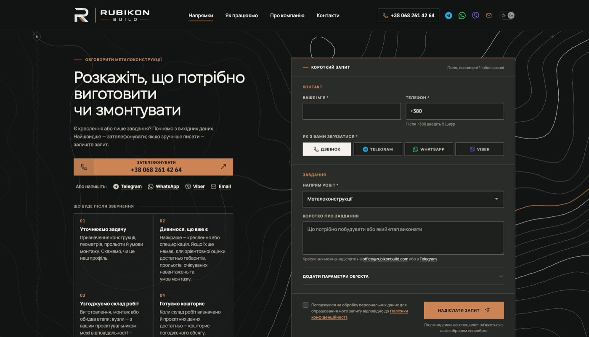
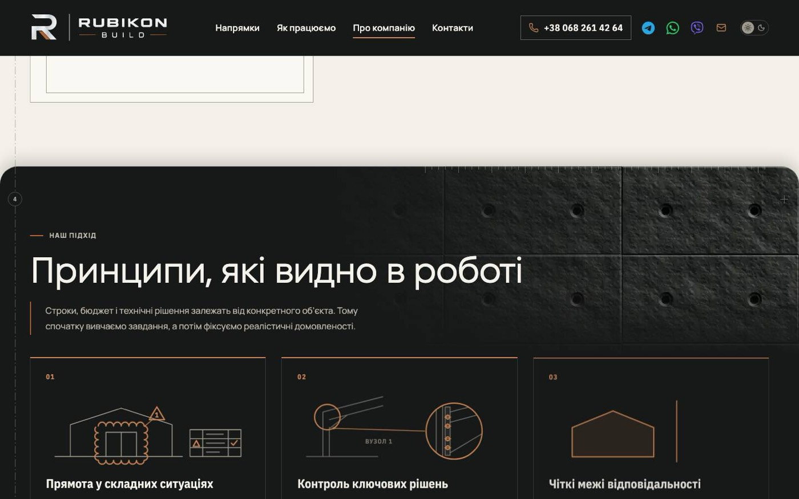
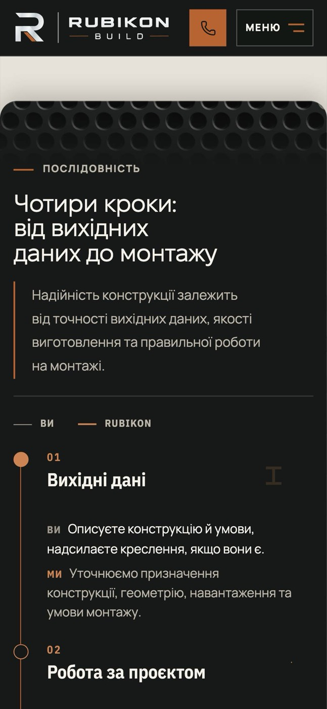
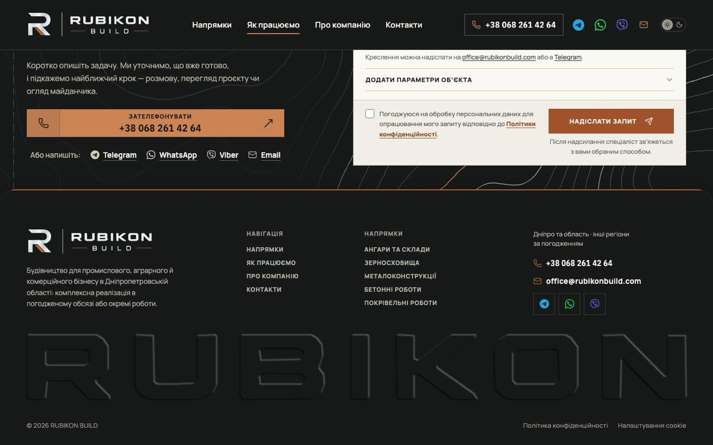

# Handoff · Доведення вигляду за незалежним рев'ю

| | |
|---|---|
| Дата | 2026-11-01 |
| Виконавець | Claude Code |
| Підстава | Власник, 01.11, після рев'ю чотирьох незалежних агентів: «виправимо баги і зробимо красоту на основі покращення звіту» |
| PR | [#294](https://github.com/leusd100/rubikon-build/pull/294), Draft. **Merge і production deploy — лише з окремого OK Дмитра** (DEC-30) |
| Гілка / base | `design/visual-polish` від `main` `e72daa01` |
| Коміти | `1185988e` — вигляд, тести · `c9596730` — handoff · `7a2f66db` і наступні — живі сцени |
| Змінено | `app/conversation.css`, `app/components/page-sheets.css`, `app/components/page-materials.css`, `app/components/FooterSignature.tsx`, `app/globals.css`, `scripts/generate-material-tiles.mjs`, `scripts/generate-material-scenes.mjs` (новий), дві плитки, 13 SVG-сцен, `tests/e2e/page-sheets.spec.ts`, `tests/unit/page-materials.test.ts` |
| Не змінено | Тексти, форма, залежності, бюджети, еталони, CSP |

Незалежний від [#293](https://github.com/leusd100/rubikon-build/pull/293): спільний лише `FooterSignature.tsx`, різні рядки. Рух там, вигляд тут.

## Що було

Рев'ю знайшло огріхи на вже опублікованих сторінках: контури форми обривались прямою лінією, темна тінь бруднила папір, на телефоні матеріал стояв смугою під міткою, сусідні аркуші одного тону зливались.

## Що зроблено

1. **Контури** ростуть із шириною блоку: `max(1800px, calc(100% + 240px))`, на вузьких ширинах `max(1000px, calc(100% + 340px))`. Обрив на x=1680 при 1920 px зник.
2. **Тіні.** Над папером легша, `0 -8px 28px` .2. У темній темі лінія світла .2 і тінь .28, щоб шов читався.
3. **Телефон:** `--material-void: 76px` до 760 px, матеріал закінчується над міткою.
4. **Живі сцени.** Власник 01.11 про зерно: «ось такі елементи прям дуже солідно виглядають», і просив, щоб сторінки не повторювали один образ. Кожен напрямок тепер говорить своїм предметом у порожнечі світлого блоку: іскри зварювання, заливка в опалубку з арматурою, сніг, який малює дах ангара, дощ на схилі, розсип, що шикується в чотири етапи, знак у піску на /pro-nas. На хабі п'ять потоків замість другої перфорації. Лише від 1181 px, як і зерно. У формі на кожній сторінці свій шматок контурів. /pro-nas лишається на шліфованій сталі: заміна на бетон із рев'ю повторила б сторінку бетону.
5. **Тихіші плитки:** `knurl-dark` k .7, spec .35; `dots-paper` k .7.
6. **Підпис у футері** чіткіший: blur .55, зсув .7, світло .36.
7. **Ритм:** `.proc-responsibility` і FAQ після блоку вартості тоном відрізняються від сусідів.
8. **Дзвінок у шапці** мідний, коли герой уже прокручено: у глибині сторінки це єдиний контакт на екрані.

**Не зроблено, рішення власника:** новий токен міді на темному (OD-PX-10), реквізити у футері (потрібні реальні дані), повтор контакту посеред сторінок.

## Перевірка

| Перевірка | Команда / прогін | Результат |
|---|---|---|
| Типи, збірка | `tsc`, `vinext build` | чисто |
| Unit | `vitest run` | бюджет ваги тримається, сцени до 45 КБ кожна, gzip близько 18 КБ |
| e2e, production-збірка | `page-sheets`, `decor-backgrounds`, desktop + mobile | 24 passed, 21 skipped |
| Вигляд | прев'ю гілки, кадри 1920, 1440, 390, Light і Dark | контури до краю, мітка чиста, дзвінок `rgb(183, 100, 50)` при `scrolled`, вісім сторінок зі сценами й контурами, запитів матеріалів із помилкою 0 |

Контраст тексту після правок окремо не перемірявся. Safari і iPhone не перевірені.

## Еталони

Не оновлювались. Зміняться широко: тіні, тони, матеріали. Оновлення лише з OK власника після `visual-freeze`, Linux-PNG з артефакту CI цього коміту (DEC-18).

## Успадковані червоні перевірки

Немає відомих.

## Ризики

- Сцени вантажаться на сторінці незалежно від того, чи дійшов відвідувач до блоку: на десктопі плюс один SVG до 45 КБ. Lighthouse локально не запускався.
- Плитки `tread-*`, `panel-paper`, `sheet-paper`, `dots-paper`, `concrete-paper` на десктопі більше не використовуються, змінні й файли лишились. Видалення окремо, з OK.
- Мідний дзвінок помітніший, але чи дає це більше дзвінків, не виміряно.
- Тон `.proc-responsibility` і FAQ змінює сторінки, де блок раніше збігався із сусідом. Варто глянути очима.
- Контури на 2560 px масштабуються разом із блоком, лінії стають дещо ширшими.

## Що перевірити власнику

1. Форму на широкому екрані й тіні між аркушами.
2. Сцени на всіх сторінках, у світлій і темній темі.
3. Мідний дзвінок на телефоні.

## Відкат

Revert PR. Міграцій і залежностей немає.

## Пропоновані оновлення control (лише після OK)

`DECISIONS`: DEC-44: матеріал на темному блоці, сцена свого предмета на світлому, контури у формі різні на кожній сторінці.
