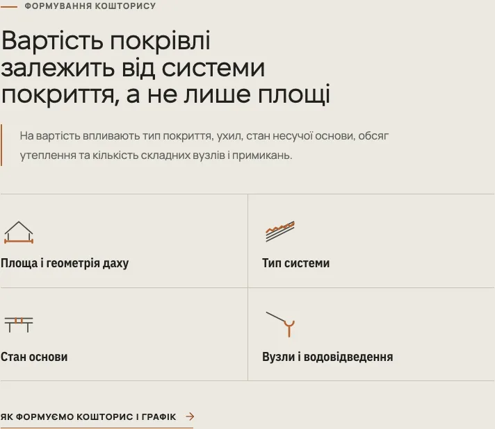
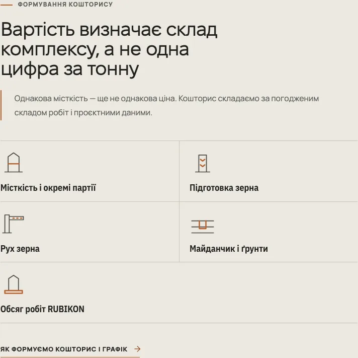
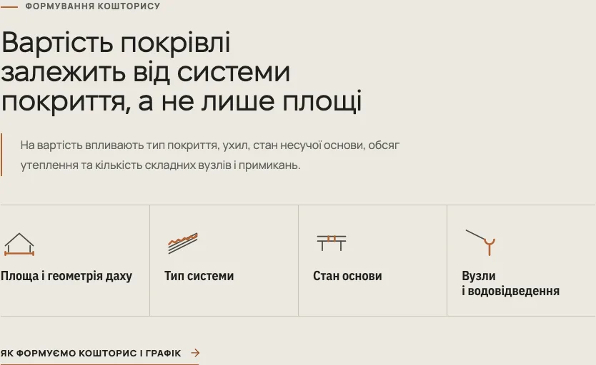

# Handoff · Main червоний після #317: чинники вартості 2 × 2 і еталони direction-cost

| | |
|---|---|
| Дата | 2026-11-20 |
| Виконавець | Claude Code |
| Підстава | Main Regression і Nightly червоні на `96aa2629` (#317); через це червоний PR Gate на #320. Власник 20.11: «Так, окремий PR» (сітка 2 × 2 і три еталони) |
| PR | [#321](https://github.com/leusd100/rubikon-build/pull/321), Draft. **Merge і production deploy — лише з окремого OK Дмитра** (DEC-30) |
| Гілка / base | `fix/main-red-after-317` від `main` `96aa2629` |
| Коміти | `6066f1b3` — CSS 2 × 2 · еталони з артефакту CI + handoff |
| Змінено | `app/components/directions/direction-template.css` (одне правило для 761–899 px), три Linux-еталони `direction-cost-*` |
| Не змінено | Тексти, чинники, значки, блок ≤ 760 px і від 900 px, `/angary` (там інший блок вартості) |

## Що було

Main Regression і Nightly на `96aa2629` падали на тих самих чотирьох тестах.

- **`visual.spec.ts` «representative direction cost» на 375, 768 і 1440.** #317 навмисно стиснув блок: замість чотирьох рядків із реченнями — ряд назв зі значками й посилання «Як формуємо кошторис і графік». Еталони лишились старі.
  - Висота знімка: 1440 — 795 → 593 px, 768 — 777 → 534 px, 375 — 923 → 654 px.
  - Diff переглянуто: зміна саме та, що в #317, нічого стороннього.
- **`words-whole.spec.ts` на `/pokrivelni-roboty`, 761 px.** Ряд із чотирьох назв лишає назві 156 px, і «водовідведення» з «Вузли і водовідведення» рветься посеред слова.
  - Розгортка в Chrome на macOS: так від 761 до ~770 px.
  - Інші три сторінки — без розривів.

## Що зроблено

Від 761 до 899 px назви чинників стоять два на два.

- Ряди зберігають свої лінії; вертикальна лінія між колонками лише в правій.
- П'ята назва (`/zernoskhovyshcha`, «Обсяг робіт RUBIKON») займає останній ряд повністю.
- До 760 px і від 900 px — як було.

| 768 px, `/pokrivelni-roboty` | 768 px, `/zernoskhovyshcha` | 900 px — один ряд, як було |
|---|---|---|
|  |  |  |

## Перевірка

| Що | Як | Результат |
|---|---|---|
| Розірвані слова | `words-whole.spec.ts` | на main (production) падає: «761px / 768px h3 «водовідведення» split»; на гілці 11/11 |
| Розгортка ширин | 761–1100 px через 3 px, чотири сторінки напрямів | жодного розірваного слова |
| Fast Gate | lint, typecheck, unit, build | чисто; 1844 passed |
| Critical e2e | `pr-critical.spec.ts`, desktop + mobile | 114 passed |
| Job `hero` | `hero-video` · `theme` ×3 · direction artwork · `home-proof-contour` | 68 · 66 · 14 · 4 passed |
| Еталони | `direction-cost-{mobile-375,tablet-768,desktop-1440}-linux.png` з артефакту `changed-area-visual-diff` прогону 44722579291 (head `6066f1b3`) | три спроби кожного знімка піксель у піксель однакові. 1440 — один ряд, як у #317; 768 — новий 2 × 2; 375 — список, як у #317. «…за окремим» на 375 стоїть упритул до краю блоку, але не обрізане |

## Еталони

OK власника 20.11 у відповідь на пропозицію «2 × 2 + 3 еталони». Linux-PNG — лише з артефакту CI того самого коміту (DEC-18). Кожен diff переглядається до коміту. `-darwin` не оновлюються: CI їх не використовує.

## Що перевірити власнику

1. Вигляд 2 × 2 на планшеті (761–899 px) — знімки вище.
2. Merge. Після нього до #320 підтягується main, і його PR Gate стає зеленим.

## Відкат

Revert — одне CSS-правило і три PNG. Без правила на 761–770 px «водовідведення» знову рветься.
