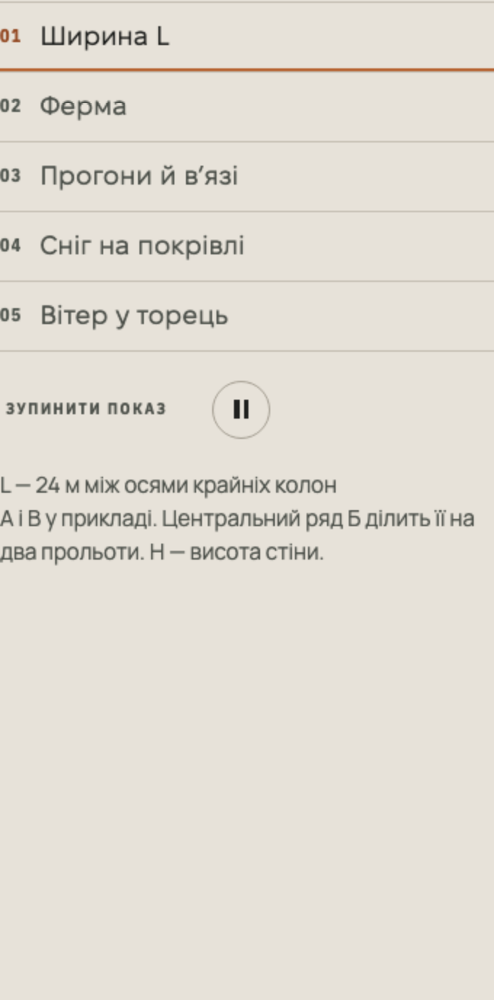
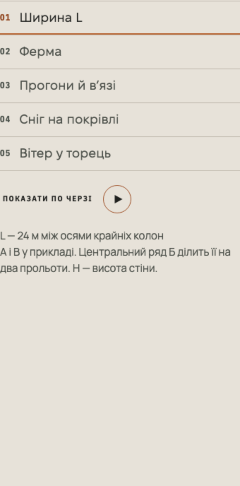

# Handoff · Тур «Приклад каркаса» на HOME без зсуву: флейк home-proof-contour:2173 (1A)

| | |
|---|---|
| Дата | 2026-11-22 |
| Виконавець | Claude Code |
| Підстава | Програма робіт, крок 1A. Main Regression [45005067648](https://github.com/leusd100/rubikon-build/actions/runs/45005067648) на `65053eeb`: «flaky» `home-proof-contour.spec.ts:2173`, шостий раз з 07.11. Рішення власника 22.11 «Так, у Docker» |
| PR | [#332](https://github.com/leusd100/rubikon-build/pull/332), Draft. **Merge і production deploy — лише з окремого OK Дмитра** (DEC-30) |
| Гілка / base | `fix/home-frame-text-shift` від `main` `65053eeb` |
| Змінено | `app/components/useDrawingTour.ts` (`motion` під час рендеру, один `MediaQueryList`), `app/home-v2.css` (місце під довший підпис кнопки туру), `tests/e2e/home-frame-tour.spec.ts` (новий тест) |
| Не змінено | Тексти, еталони, бюджети, залежності; наявні тести |

## Що було

**Історія.** `home-proof-contour.spec.ts:2173` («arriving with motion…») пройшов лише з повтору в MR `04594b17`, `a4c6420b`, `38292108`, `29924943`, `65053eeb` і в Nightly 15.11. Щоразу зсувався `.hv2-frame-text`, текст кроку туру «Приклад каркаса» в тій самій секції HOME. #328 звузив тест до своєї секції, але цей блок у ній і є.

**macOS.** Не відтворюється. Перевірено:
- затримку ледачого чанка `HomeFrameTour` до 3 с;
- затримку всіх шрифтів до 5 с;
- прокрутку коліщатком.

**Образ CI** (`mcr.microsoft.com/playwright:v1.62.1-noble`, linux/amd64). Сервер — production-збірка на хості, у контейнері `127.0.0.1:4173` переадресовано на хост.
- Без змін: 4 з 6 прогонів падають на `.hv2-frame-text`.
- Із записом координат зсуву: 6 з 6, щоразу `y 206 → 268`, тобто текст опустився на 62 px, а висота лишилась та сама.

## Корінна причина

`useDrawingTour` тримав `motion` (reduced motion вимкнено) у `useState(false)` і ставив `true` в `useEffect`, тобто після першого кадру. Тур на HOME монтується ліниво, коли відвідувач наближається (`FrameTourIsland`). Тест робить те саме: стрибок `approach()` повз тур до доказу. На повільній машині кадр без кнопки «Показати по черзі» (44 px + відступ = 62 px) встигав намалюватись. Потім кнопка з'являлась, і текст кроку під нею зсувався. Це справжній зсув макета на екрані, хоч і малий (≈0,002).

## Що зроблено

1. **`useDrawingTour`.** `motion` читається під час рендеру через `useSyncExternalStore(matchMedia('(prefers-reduced-motion: reduce)'))`; на сервері й під час гідратації — `false`, як і раніше. Ліниво змонтований тур малюється з кнопкою з першого кадру. Зупинка показу при ввімкненні reduced motion посеред туру тепер у зворотному виклику `change`, як і була. Шаблон уже є в `FrameTour.tsx:714` (`watchWideSheet`).
2. **Другий зсув, що проявився після першого виправлення** (1 з 10 прогонів). Іконка кнопки стоїть після підпису. Коли тур сам запускається, підпис змінюється: «Показати по черзі» → «Зупинити показ», 127 → 111 px при 11 px, однаково на Linux і macOS. Через це іконка їхала. Підпис на HOME отримав місце під довший варіант (`min-width: 12em` = 132 px), як уже зроблено на `/angary` (`.hc-frame-play .dn-control-label`, `configurator-controls.css:258`) і в штампах (`direction-node.css:66`).

## Перевірка

| Перевірка | Як | Результат |
|---|---|---|
| Образ CI, `:2173`, `--workers=1 --retries=0` | `--repeat-each=20` | **0 зсувів** (було 4/6). 1 падіння таймінгу `ended − run ≥ duration − 20`: повільність емуляції amd64 на Apple silicon, описана в handoff 26.10; у CI цього немає |
| Lint, typecheck, unit | Fast Gate | 0 помилок; 1913 passed, 1 skipped |
| critical | `pr-critical.spec.ts` | 58 passed |
| Тури, що використовують `useDrawingTour` + острови + X-Ray | home-frame-tour, direction-node, pro-nas-practice, angary-interactive, configurator-polish, observer-batches, island-failure, home-proof-contour × desktop/mobile-chromium | 250 passed, 68 skipped, 2 failed — `home-proof-contour` «Навантаження» `:3277`, `:3328` (див. нижче) |
| Reduced motion | усі тести з «reduce»/«reduced motion», desktop | 56 passed |
| Класифікатор | `classify-changes.mjs` | visual (wide) |
| **Новий тест** `home-frame-tour.spec.ts` «the tour comes in with its control in place…» | `--repeat-each=8`, гілка | 8 passed |
| Той самий тест без виправлення хука (код main) | `--repeat-each=3` | **3 failed** — «the control was in the tour as it came in» |
| Той самий тест без CSS-резерву | `--repeat-each=3` | **3 failed** — «the icon did not move with its words» |
| Увесь `home-frame-tour.spec.ts` | desktop + mobile-chromium | 26 passed, 2 skipped |
| Незалежне рев'ю | субагент `reviewer` | approve with changes: регресійний тест без таймінгу (додано), коментар хука уточнено, один `MediaQueryList`; проміжок підпис–іконка — до відома власника |

Візуальні еталони не зачеплено: `visual.spec.ts` знімає з `reducedMotion: 'reduce'`, а тоді кнопки туру немає.

## Відхилено

- **«Ця зміна ламає «Навантаження» X-Ray».** Спершу виглядало так: main 0/18 проти гілки 4/18. Але повтор із записом часу кліку дав main **8 падінь з 10**, гілку 10 з 10 зелених.
  - Тести `:3277`/`:3328` натискають «Навантаження» з розрахунку, що вузол ще збирається. Вікно на це — ≈2,2 с.
  - Під навантаженням цієї машини тест доходить до кліку за 0,7–2,5 с: і на main, і на гілці.
  - Логіку готовності продукту зміна не зачіпає: X-Ray не використовує `useDrawingTour`.
- **Пізній шрифт, пізній чанк туру** — див. «Що було».

## Еталони

Не змінювались.

## Успадковані червоні перевірки

`home-proof-contour.spec.ts:3277`, `:3328` («Навантаження») під локальним навантаженням: тест не встигає натиснути, поки вузол збирається. Відтворено на `origin/main` 8 з 10. У CI останнім часом не падали. Окрема задача: тримати збирання (паузою анімацій) **до** відкриття, а не після.

## Ризики

- Спільний хук для чотирьох турів. Для тих, що рендеряться на сервері, під час гідратації `motion` = `false`, як і раніше. Потім `useSyncExternalStore` синхронно оновлює значення ще до кадру (раніше — після кадру в ефекті).
- Мінімальна ширина підпису кнопки на HOME: у стані «Зупинити показ» між підписом та іконкою на ~21 px більше повітря.

## Що перевірити власнику

Кнопку туру «Приклад каркаса» на HOME у двох станах (1440, знімки нижче). Іконка тепер стоїть на одному місці. Ціна — проміжок між підписом та іконкою: ≈15 px у «Показати по черзі» і ≈31 px у «Зупинити показ» (було 10 px, а іконка їздила).

**Альтернатива на вибір.** Вирівняти підпис праворуч (`text-align: end`): проміжок лишиться 10 px, зате ліва межа підпису змінюватиметься між станами. Візуальних еталонів не зачіпає жоден варіант.

| Грає сам | Пауза |
|---|---|
|  |  |

## Відкат

Revert PR.
